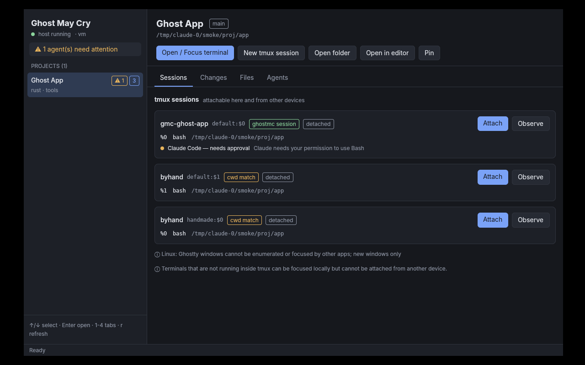

# Ghost May Cry (`ghostmc`)

A fast, local-first control center for your projects, tmux sessions and CLI
coding agents.

From a project you can find the session that is *already running* — in tmux or
in a Ghostty window — and focus it or reattach to it instead of starting over.
You can see whether Claude Code or Codex is working, waiting for approval, or
done with its turn, look at changed files, and pick up the same tmux session
from another Mac or Linux machine over SSH (for example over Tailscale).

`MC` stands for *Mission Control*, or *May Cry*. Ghost May Cry is a personal
tool. It is not affiliated with Ghostty or Devil May Cry, and it is not a
terminal emulator, an IDE, a cloud service or an AI client. It works with
tools you already use: **Ghostty**, **tmux**, **git**, **ssh**, your editor.



## Status

This is the first vertical slice. The project registry, tmux discovery, create,
focus and reattach, remote attach over SSH, agent hooks, git and files, the CLI
and a GPUI desktop app work and are tested. macOS-specific paths (Ghostty
AppleScript, LaunchAgent) are implemented from Ghostty's published scripting
dictionary but **have not been run on a Mac yet**. See [MVP.md](MVP.md) for
what works, what is partial and what has not been tested, with evidence.

## How it fits together

```
ghostmc-desktop (GPUI) ─┐                      ┌─ tmux servers
ghostmc (CLI) ──────────┼── Unix socket ── host ┼─ SQLite registry
agent hooks ────────────┘                      └─ git, files
```

- The **host** (`ghostmc host run`) is an ordinary user process that keeps the
  registry, talks to tmux, collects agent events and sends notifications. It is
  optional: without it, the CLI does the same work itself ("direct mode").
- **tmux owns your sessions.** Only sessions that run inside tmux can be
  attached from another device. A plain Ghostty window can be found and
  focused on its own machine, but it cannot be attached from anywhere else.
- **Ghostty stays your terminal.** ghostmc opens or focuses real Ghostty
  windows. It never draws a terminal of its own.

The design and its security model are explained in
[docs/adr/0001-architecture.md](docs/adr/0001-architecture.md).

## Install

You need Rust 1.88 or newer (tested with 1.97), plus `tmux` (3.2 or newer;
tested with 3.4), `git`, and optionally Ghostty and `ssh`.

### macOS

```sh
xcode-select --install          # full Xcode is needed for GPUI's Metal shaders
brew install tmux
cargo install --path crates/ghostmc-cli        # installs `ghostmc`
cargo install --path crates/ghostmc-desktop    # installs `ghostmc-desktop`
```

Ghostty 1.3 or newer is needed for AppleScript. The first time ghostmc focuses
or opens a Ghostty window, macOS asks for Automation permission. You can change
it later in System Settings → Privacy & Security → Automation.

### Fedora

```sh
sudo dnf install tmux git gcc clang cmake pkgconf-pkg-config \
  libxkbcommon-devel libxkbcommon-x11-devel wayland-devel vulkan-loader-devel \
  fontconfig-devel freetype-devel libxcb-devel libX11-devel
cargo install --path crates/ghostmc-cli
cargo install --path crates/ghostmc-desktop
```

The Fedora package names are mapped from the Ubuntu 24.04 packages used for
development and have not yet been checked on Fedora. On Ubuntu/Debian the
equivalents are `libxkbcommon-dev libxkbcommon-x11-dev libwayland-dev
libvulkan-dev libfontconfig-dev libfreetype-dev libxcb1-dev libx11-xcb-dev`.

## Build, run, test

```sh
cargo build                       # host + CLI (the desktop app is not a default member)
cargo build -p ghostmc-desktop    # desktop app (pulls in GPUI)
cargo test                        # all host/CLI tests; tmux tests use private sockets
cargo test --workspace            # also compiles the desktop crate
cargo run -p ghostmc-desktop      # start the desktop app
```

`Cargo.lock` pins `libc` to 0.2.186 because GPUI 0.2.2 depends on `xattr`
0.2.3, which does not build against newer `libc`. Don't run a blanket
`cargo update` without checking that the desktop crate still builds.

Set `GHOSTMC_HOME=/some/dir` to use a separate registry, config and socket, for
example to experiment without touching your real data.

## Quickstart

```sh
ghostmc project add "Ghost App" --path ~/code/ghost-app -t rust
ghostmc open "Ghost App"
```

`open` lists everything related to the project's folder:

- **tmux sessions.** ghostmc tags the sessions it creates, so they are matched
  for certain. Other tmux sessions whose panes are in the folder are shown as
  possible matches for you to choose from.
- **Ghostty terminals** that are not running tmux (macOS only). These can be
  focused but not attached.

Then it focuses or attaches the one you choose. If nothing is running, it
offers to create a tmux session. It never creates one without asking, and it
never restarts an agent.

```sh
ghostmc open "Ghost App" --create         # create a session if none exists, then attach it
ghostmc new "Ghost App"                    # create (or reuse) the ghostmc session, don't attach
ghostmc new "Ghost App" --additional -- codex   # a second session running `codex`
ghostmc sessions                           # every tmux session on this machine
ghostmc attach gmc-ghost-app --observe     # read-only, does not resize the session
ghostmc git status "Ghost App"; ghostmc git diff "Ghost App" src/main.rs
ghostmc files "Ghost App" src; ghostmc edit "Ghost App" src/main.rs
```

Add `--json` to any command for machine-readable output, or `--dry-run` to an
attach to print the exact command instead of running it.

### Agent status (Claude Code, Codex)

```sh
ghostmc hook install          # adds hooks to ~/.claude/settings.json and ~/.codex/hooks.json
ghostmc agents                # running / needs approval / turn ended / …
ghostmc hook uninstall        # removes only ghostmc's hooks
```

Installing hooks keeps your existing hooks and settings and writes a backup
first. In Codex, approve the new hooks with `/hooks` before they run. ghostmc
records event names, ids, the tmux pane and short notification texts. It never
stores your prompts or the agent's replies. Agents started inside a session
that ghostmc created are linked to that session through a token, so the link
is verified. For other agents, ghostmc labels how sure it is about the match.

### Background host and notifications

```sh
ghostmc host install --start            # systemd --user unit (Linux) or LaunchAgent (macOS)
ghostmc host install --start --at-login # also start at login (opt-in)
ghostmc host uninstall
```

With the host running, you get a system notification when an agent needs
approval, fails or ends its turn. On Linux, clicking **Open** in the
notification attaches that session. The desktop app updates as soon as events
arrive.

### Continue on another device

On the device you work from:

```sh
ghostmc device add mini --ssh me@mini.tailnet-name.ts.net   # any working `ssh` target
ghostmc device check mini                                   # runs `ghostmc api` over ssh
ghostmc sessions --device mini
ghostmc project link "Ghost App" /Users/me/code/ghost-app --device mini
ghostmc open "Ghost App" --device mini              # attach the existing session over ssh
ghostmc open "Ghost App" --device mini --observe    # watch it read-only
ghostmc attach gmc-ghost-app --device mini --here --keep-size   # in this terminal, without resizing
```

Requirements:

- `ghostmc` is installed on the other device. If it isn't on that device's
  `PATH`, add `--ghostmc /path/to/ghostmc`.
- `ssh <target>` already works without a password prompt, and the host key is
  already in `known_hosts`. ghostmc never weakens host key checking.

From a phone, any SSH app can run the attach command that
`ghostmc attach … --dry-run` prints.

`scripts/verify_remote_attach.py --device NAME --ghostmc $(which ghostmc)`
checks the whole flow against a real device. It runs a test program in a
throwaway tmux server and attaches an observer, a writable client and a
`--keep-size` client over SSH. It then checks that input arrives, that the
observer can't type, that sizes stay the same, and that the program is never
restarted. `ssh localhost` works as a target if you only have one machine.

## Configuration

`~/.config/ghostmc/config.toml` (Linux) or
`~/Library/Application Support/ghostmc/config.toml` (macOS). All keys are
optional:

```toml
[tmux]
binary = "tmux"
sockets = ["work"]          # extra servers (tmux -L names or socket paths)
create_on_socket = ""       # "" = your default tmux server

[terminal]
kind = "ghostty"            # or "custom"
linux_mode = "new-window"   # "new-window" (D-Bus) or "spawn"
custom = ["foot", "--"]     # used when kind = "custom"; the command is appended

[editor]
command = ["zed"]           # default: open / xdg-open

[notifications]
enabled = true
on_turn_end = true
```

## Platform support

| | macOS | Fedora / Linux |
|---|---|---|
| Registry, tmux, CLI, host, hooks, git, files | yes | yes (tested on Linux) |
| Desktop app (GPUI) | expected to build (Metal); not yet built or run | yes (tested on X11) |
| List and focus Ghostty terminals | AppleScript (untested) | not possible: Ghostty has no API for it, so the feature is disabled |
| Open Ghostty window or tab | window and tab (untested) | window only (`ghostty +new-window`, or a new process) |
| Remote attach over SSH | yes | yes (tested over loopback SSH) |
| Clickable notifications | shown, not clickable | `notify-send --action` |

## Limitations

- A terminal that isn't running inside tmux can't be attached from another
  device. Start work you may want to continue elsewhere in a tmux session
  (`ghostmc new`).
- The desktop app can't add or rename projects yet; use the CLI for that.
- Remote session creation is off. Create sessions on the device itself.
- There is no live terminal view inside the dashboard. Attaching always opens a
  real terminal.
- Anyone who can SSH into your account has full access, including typing into
  any session. Observe mode only stops *that one client* from typing; it is not
  a security boundary.

## Repository layout

```
crates/ghostmc-core       domain model, SQLite registry, matching, agent state, git, files, hook config
crates/ghostmc-tmux       tmux CLI driver (discovery, tagged creation, attach argv)
crates/ghostmc-protocol   versioned request/response types
crates/ghostmc-platform   Ghostty, editor, file manager, notifications
crates/ghostmc-host       service, Unix-socket server, SSH remote client, desktop helpers
crates/ghostmc-cli        the `ghostmc` binary
crates/ghostmc-desktop    the GPUI app
scripts/                  real-device verification
docs/adr/                 architecture decisions
```

## License

GPL-3.0-or-later. GPUI is Apache-2.0.
